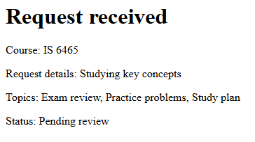
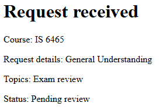

Part 1:
Visited request-form.php, and submitted a valid tutoring request.  The result:

Part 2:

Header.php includes header information (such as meta, links to stylesheets, etcetera) and sets the title of the tab to "Peer Tutoring Hub."

Nav.php provides the navigation links used to navigate between php pages.

Footer.php provides a border and a neat footer at the bottom of the webpage.

Require_once is fitting because it allows other php files to include those files, and prevents them from accidentally being included multiple times.  There's no reason to have multiple footers, for example.

The shared CSS file is linked through header.php.

Part 3:

PHP will receive string values for all controls, except for Topics[], which instead returns a string array.

Reason: Contains a students specific reasoning for what they need tutoring on.
Topics[]: An array containing all of the topics that a student wishes to cover during their tutoring session.
Preferredtime: The time which a student prefers to have their tutoring session.
Preferreddate: The date during which a student prefers to have their tutoring session.
Form_name: The name of the submission form.  Prevents submitting invalid forms.

Part 4:

Test 1: Exam Review, IS 6465, "General Understanding," Morning, 11/02/2026.  

Request was accepted, application displayed this message:

Business rule being checked: All inputs are valid; Course is valid, reason given, at least one topic selected, time valid, date valid, valid form.

Test 2: [Topic left blank], IS 6465, "General Understanding," Morning, 11/02/2026.

Request could not be submitted.  Additional note, "select at least one valid topic."

Business rule being checked: Must select at least one valid topic

Test 3: Exam Review, IS 6465, "General Understanding," Morning, 10/31/2026.  

Request could not be submitted.  Additional note, "Preferred date cannot be in the past."

Business rul ebeing checked: Must select a date today or later.

Part 5

Valid time: PASS
Missing time: PASS
Altered value: PASS
Multiple valid topics: PASS
Missing topics: PASS
Altered topic: PASS
Minimum length: PASS
Maximum length: PASS
Too short: PASS
Too long: PASS

Create: request-form.php
Read one request: request-details.php
Read all requests: requests.php
Update: edit-request.php
Delete: delete-request.php

1. request_id
2. Because we only need the details of one specific request, which means we can get specifically that one (via request_id)
3. We're attempting to update information, thus we need to use a post request.