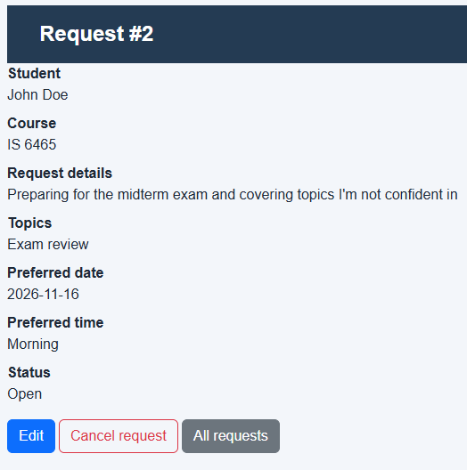

Part 1

Ran command .tables in sqlite to confirm tables, and got both "students" and "tutoring_requests"

Part 2

Upon running php -S 0.0.0.0:8000, this is the URL i was redirected to: 

https://effective-space-halibut-p4qwpqxv9r7c77r9-8000.app.github.dev/php/request-form.php

Created a request with this information:

Student: John Doe
Course: IS 6465
Request details: Preparing for the midterm exam and covering topics I'm not confident in
Topics:Exam review
Preferred date: 2026-11-16
Preferred time: Morning
Status: Open

Part 3

| Test: |  What I Did: | Expected Result: | Actual Result: | Pass or Fail:|
|-------|--------------|------------------|----------------|--------------|
|Submit a valid request| Created a request with the above information | A new tutoring request is created with status Open | A new tutoring request was created with status Open | Pass |
|View all requests | clicked on the "all requests" button in the details page of the newly created request | the new request appears in the request list | the new request appeared in the request list | Pass |
|Filter requests | tried changing filter conditions to ensure that requests appeared when they met the conditions and didn't if they didn't | Filtering by course or status shows matching requests| Filtering by course or status showed matching requests | Pass|
|Edit an Open Request | Changed every single variable from the original valid request | the revised values are displayed | the revised values were displayed | Pass|
|Cancel an Open Request | Clicked the "cancel" button on request details page, then verified yes to cancel it| the request status changes to Cancelled | the request status changed to Cancelled| Pass|
|try to edit or cancel a cancelled request| checked the details of a cancelled request, saw no option to edit the details, and also tried to access the edit page of cancelled request by accessing different edit page and changing the request_id parameter to the cancelled request ID, which didn't work either | the application does not allow the change | the application did not allow the change | Pass| 

Part 4

1.) request-form.php
2.) process-request.php
3.) db.php
4.) requestService.php
5.) tutoring.sql, requestPDO.php, and studentPDO.php
6.) students
7.) tutoring_requests
8.) through the foreign key connection using student IDs.

Simply put, to separate our concerns.  It's best to subdivide software files depending on what files need to handle what tasks.  This has the benefit of giving added security and making it all easier to organize.

Part 5

While running the integration tests, I was getting an error where three of the tests would fail.  I hadn't made any changes to any of the code at this time.  I did some debugging assisted by ChatGPT (some of the debugging statements can still be found in integration-tests.php), which determined that the errors were coming from pre-inserted student information in setup-databse.sql.  Once I commented out the code inserting Maria Lopez and her tutoring request into the database, all of the tests ran cleanly.

PASS UC01 create and Open
PASS Lab 4 checkbox values preserved
PASS Duplicate email reuses student
PASS UC02 course and status filter
PASS Invalid reason rejected
PASS Invalid submission writes nothing
PASS Edit Open request
PASS Updated reason persisted
PASS Cancel Open request
PASS Cancelled row retained
PASS Second cancellation rejected
PASS Unrelated request unchanged
PASS FK enforced
PASS UC02 empty filter result
All integration checks passed

Part 6

My Prompt: Explain how a tutoring request moves from php/request-form.php through PHP, PDO, and SQLite in this project. Identify the responsibility of each file.

Ai Response: When a student submits a tutoring request through php/request-form.php, PHP collects the form data and passes it to requestService.php. The service validates the information using functions from includes/validation.php and coordinates the database operations. The studentPDO.php repository checks whether the student already exists and inserts a new student if necessary. The requestPDO.php repository uses PDO prepared statements to insert the tutoring request into SQLite, linking it to the student's ID. The SQLite database stores the records using the tables and constraints defined in setup-database.sql. The service uses a transaction to ensure that database operations either complete successfully or are rolled back if an error occurs. This structure separates the user interface, business logic, and database operations, making the application easier to maintain and test.

My Prompt: Trace the requirement “a student can submit a tutoring request” through the PHP files, service, repositories, SQLite tables, and integration tests in this project.

Ai Response: The requirement "a student can submit a tutoring request" begins in `php/request-form.php`, where students enter their information and submit the form. PHP passes the submitted data to `requestService.php`, which validates the information using `validation.php` and coordinates the database operations. The `studentPDO.php` repository checks whether the student already exists and creates a new record if necessary, while `requestPDO.php` inserts the tutoring request using PDO prepared statements. SQLite stores the information in the `students` and `tutoring_requests` tables, linked by the `student_id` foreign key. New requests receive an `Open` status by default. Finally, `integration-tests.php` verifies that requests are successfully created, student records are reused, submitted topics are preserved, and invalid submissions are rejected. Together, these components implement and test the tutoring request submission requirement.

| Requirement | Application Page| Service or Validation | Repository or SQL | Databse Table | Test Evidence|
|-----|-----|-----|-----|-----|-----|
|student submits a tutoring request | php/request-form.php | requestService.php: submitRequest(), validateSubmission(); validation.php | studentPDO.php: insertStudentIfAbsent(), findStudentByEmail(); requestPDO.php: insertTutoringRequest() | students, tutoring_requests | integration-tests.php, plus all it's contained tests (listed above)|

My Prompt: Suggest one useful test case for the Peer Tutoring Hub application. The test must relate to request creation, filtering, editing, cancellation, validation, or database integrity.

Ai Reponse: I'd suggest testing whether a cancelled tutoring request can still be edited, since your application already prevents cancelled requests from being modified.

1.) No, although integration-tests.php does check to see if a cancelled request can be cancelled again.
2.) Funnily enough, I've already tested it manually.  I tried accessing a page where I could edit a cancelled request through multiple avenues (directly accessing the edit page through URLs, trying to backtrack to the page through the "back" arrow, etc)
3.) I think this test is indeed appropriate.

Ai helped me unpack and simplify a lot of the information presented in this lab, as much of it was quite complicated and had a lot of moving parts.  It was particularly helpful in showing me the order of events that had to occur from the submission of information to it's reflection in the database.  

Part 7

Join, in the above query, combines the two tables by using the foreign key relationship between them to list the information in a combined, easy-to-read format.