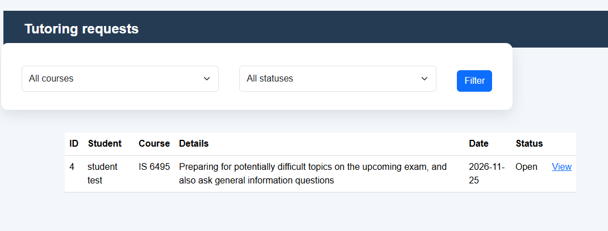
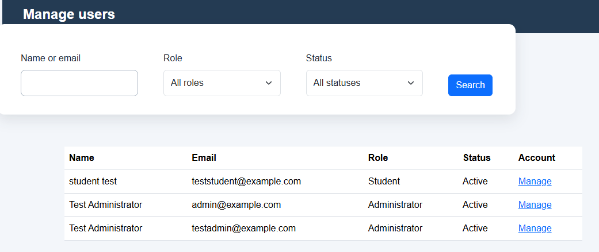

Part 1

Ai Prompt:
Generate code for all user management use cases UM-01 through UM-10 in the User Management Design Document.

Use the Application Builder, Test Harness Generator, and Traceability Auditor documents as implementation guidance. Follow the authentication, authorization, session management, password hashing, CSRF protection, and role based access practices in the Authentication Reading Handout.

Use lab6.zip as the existing Peer Tutoring Hub application to extend. Preserve the Lab 6 three tier architecture and update the application as needed to support user registration, login, logout, profile management, administrator access, and protected tutoring request workflows.

Return a complete Lab 7 application package with all updated and new files.

Files Uploaded:
- Peer Tutoring Hub User Management Design Document
- Skills pack.zip
    - Application Builder Document
    - Test Harness Generator Document
    - Tracebility Auditor Document
- Authentication Reading Handout
- lab6.zip

Lab 7 adds several new files to support logging in and authentication, and updates some preexisting files to make use of them.

An example of a generated file I verfied against the design document is the user-management.sql file.  Having it allows seamless upgrading of our preexisting database to also handle user authorization/authentication, which is something required by our design document.

Part 2

sqlite3 tutoring.db < setup-database.sql
sqlite3 tutoring.db < user-management.sql

All three tables appeared, as seen below:

sqlite> .tables
students           tutoring_requests  users            
sqlite> .quit

Part 3

php create-admin.php <admin name> <admin email> <admin password>

I checked the database after running the command to verify that the admin account had been created.  The admin email was testadmin@example.com.  The role assigned to the account is "Administrator."

Part 4

https://effective-space-halibut-p4qwpqxv9r7c77r9-8000.app.github.dev/php/login.php

The application opened successfuly; attempting to access the application without logging in (by clicking on the application name in the top-left corner) redirected me back to the login page.

Part 5

|Test|What I Did|Expected Result|Actual Result|Pass or Fail|
|----|----------|---------------|-------------|------------|
|Register Student Account|Created a new student account using test information|Student account is created|Student account is created|Pass|
|Log in as student|Attempted to log in with information from newly created student account|Student can access protected student pages|Student can access protected student pages|Pass|
|View or Update Profile|Opened student profile and attempted to update information|Profile information is displayed or saved|Profiled information is displayed or saved|Pass|
|Create Tutoring Request|Navigated to requests and created new request using test information|A new request is created with status Open|A new request is created with status Open|Pass|
|Edit Open Request|Went into open request and made changes|Updated request information is displayed|Updated request information is displayed|Pass|
|View my requests|Clicked on "view requests"|Student sees the student's own requests|Student sees the student's own requests|Pass|
|Log out|Clicked "log out" button|Session ends and login page appears|Session ends and login page appears|Pass|

Part 6

1. Authentication is ensuring that the user is who the user claims to  be
2. Authorization is making sure that the user only has permissions the user should have
3. Students can't view the list of users and can only view their own requests
4. Pages such as user lists or overviews of systems should only be limited to administrator access
5. The user is redirected back to the login page

Part 7

1. php/register.php
2. php/register.php
3. includes/auth.php, csrfToken(), csrfField(), verifyCsrfToken()
4. registerUser() in services/userService.php, accountIdentity(), newPassword()
5. registerUser() uses password_hash
6. repositories/userPDO.php, insertUser(), and repositories/studentPDO.php, ensureAccountStudent()
7. users gets a row with the Student role, and tutoring_requests gets linked to students

1. php/login.php
2. php/login.php
3. repositories/userPDO.php, findLoginUser()
4. authenticateUser() in services/userService.php, calls passwordVerify()
5. startLogin() in includes/auth.php regenerates session Id, stores user ID, session version, and creates a new CSRF token.  php/login.php then redirects to profile.php
6. helps prevent session fixation, so users who know the pre-login session Id can't reuse it
7. requireRole() checks user roles to see if they're allowed on the page, with help from users.role and requireLogin()

Part 8

Valid time: PASS

Missing time: PASS

Altered value: PASS

Multiple valid topics: PASS

Missing topics: PASS

Altered topic: PASS

Minimum length: PASS

Maximum length: PASS

Too short: PASS

Too long: PASS

PASS UM-01 Student and Tutor activate on registration
PASS UM-01 rejects duplicate, privileged role and password mismatch
PASS UM-02 safe account projection
PASS UM-03 combined search and empty result
PASS UM-04 updates name/email, blocks role modification and duplicate email
FAIL UM-09 checks credentials
PASS UM-05 rejects wrong current password and mismatched confirmation
FAIL UM-05 replaces the hash and invalidates prior sessions
PASS UM-06 blocks non-admin and last-admin demotion
PASS UM-06 administrator changes role
PASS UM-07 inactive login, invalid transition and last-admin suspension denied
PASS UM-07 administrator reactivates account
PASS Migration preserves legacy records without assigning ownership
PASS UC01/UC02 ownership derives from the account and scopes reads and writes
PASS UM-08 deletion disabled by default
PASS UM-08 retained requests and last administrator block deletion
PASS UM-08 approved policy permits deletion of eligible account
Results: 15 passed, 2 failed

Two tests passed in User management: checks credentials and replaces the hash and invalidates prior sessions.  The section of databse that stores user credentials may need to be checked, and the code that manages open sessions.

PASS UC01 create and Open
PASS Lab 4 checkbox values preserved
PASS Duplicate email reuses student
PASS UC02 course and status filter
PASS Invalid reason rejected
PASS Invalid submission writes nothing
PASS Edit Open request
PASS Updated reason persisted
PASS Cancel Open request
PASS Cancelled row retained
PASS Second cancellation rejected
PASS Unrelated request unchanged
PASS FK enforced
PASS UC02 empty filter result
All integration checks passed

All tests passed

Part 9

Ai response: php/register.php handles the HTTP request. On GET, it displays the form with a CSRF token. On POST, it passes the submitted data to registerUser() after the CSRF check succeeds. It displays validation errors or redirects the student to login.php with a confirmation message.

|Requirement|Presentation Page|Authentication or Authorization|Service or Validation|Repository or SQL|Database Table|Test Evidence|
|--|--|--|--|--|--|--|
|Student Registers an account|php/register.php|includes/auth.php|regsiterUser() in services/userService.php|repositories/userPDO.php uses prepared statement to insert Active Student into users|users|tests/user-management-tests.php|
|Student Logs In|php/login.php|startLogin in includes/auth.php regenerates and checks necessary components|authenticateUser() in services/userService.php calls findLoginUser() in repositories/userPDO.php|service checks accounts Active status and verifies|users|tests/user-management-tests.php|
|Student creates a tutoring request|php/request-form.php|php/process-request.php recieves POST|submitRequest() in servies/requestService.php validates request, ensureAccountStudent() in studentPDO.php finds or creates the students row|insertTutoringRequest() in requestPDO.php inserts the request into tutoring_requests|tutoring_requests|tests/integration-tests.php|
|User Logs Out| php/logout.php| logoutSession() clears session data|login guard reads users to validate session| N/A | users |tests/http-tests.py|

The ai suggets testing that an inactive student cannot keep using an existing session.  I believe that this is already covered in the user-management-tests.php, though I personally would also test it manually.  I think this is appropriate, as it would ensure that logged-out users cannot access sensitive data.

Part 10

Left Join includes all rows from the left table, matching rows from the right table, and if the left table has no matching rows then it simply returns the right side as empty.

The users table connect to the students table through user_id.

The application stores account information and student profile information separately because there are accounts which aren't students, e.g. administrators.

An administrator account isn't a student account, and therefore no student account was created for it in the students table.